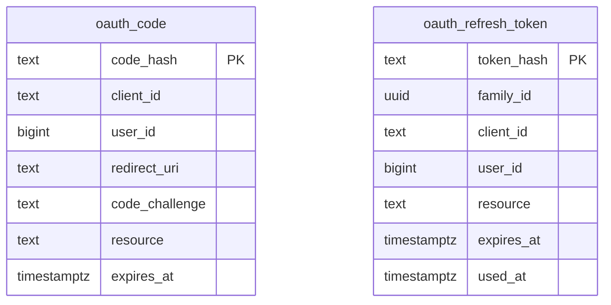
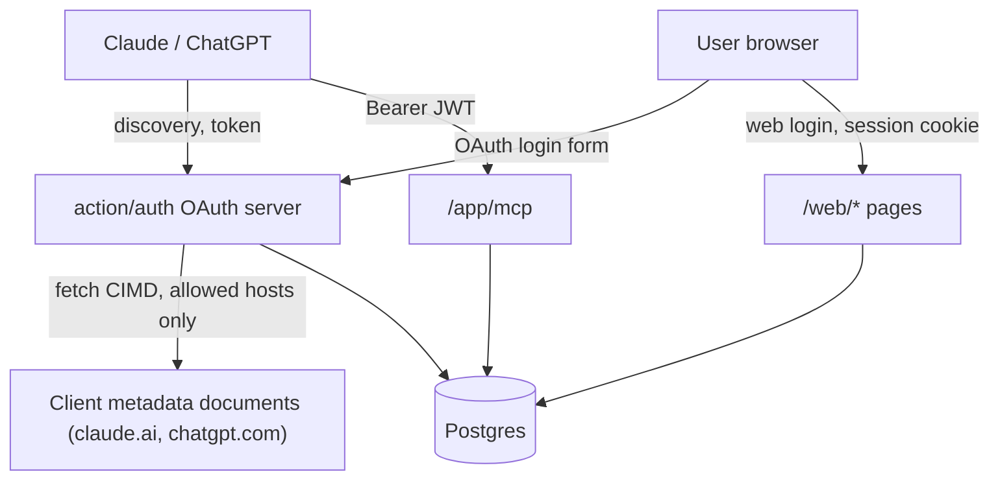

# Auth (OAuth 2.1 + Web Session) - Complete Specification

## Overview

The `action/auth` package covers two independent login flows that share one user store and one JWT secret:

1. **OAuth 2.1 Authorization Server** — protects the MCP endpoint (`/app/mcp`) for Claude and ChatGPT. The server acts as its own provider: Authorization Code flow with required S256 PKCE, a short-lived bearer JWT access token and a stored, rotating refresh token. No third-party identity provider is involved. It is not an OpenID provider: no ID token, no UserInfo, no OIDC scopes.
2. **Web Session Login** — a shared, cookie-based login for human browser access to the *new* `/web/*` dashboards (Money, Progress browse, Workouts, Navigation home page — each its own backlog item, built on top of this) plus `/money/import`. It replaces the inconsistent per-page auth that existed before: `/money/import` used to run its own HTTP Basic Auth with `IMPORT_USERNAME`/`IMPORT_PASSWORD` (now retired).

**Clients are identified only by Client ID Metadata Documents (CIMD).** A `client_id` is an HTTPS URL of the client's own JSON document, fetched on authorization. There is no client registration, no client table and no client secret: every client is public and relies on PKCE. Only `client_id` URLs on the allowed hosts (`claude.ai`, `chatgpt.com`) are accepted, so an unknown client cannot start the flow at all and the server never fetches an arbitrary URL. Claude and ChatGPT both pick CIMD when the metadata advertises it; Dynamic Client Registration (DCR) is not offered, so a client without CIMD support cannot connect.

Authorization codes and refresh tokens live in Postgres, so a restart or deploy loses nothing; expiry is an `expires_at` column checked on read. Fetched client documents are cached in memory only.

The OAuth login page names the client by the host of its `client_id` (never the self-asserted `client_name`) and shows the redirect host before the user enters a password, so it doubles as the consent screen.

Bearer tokens carry `aud` (the MCP URL) and the middleware requires it, so a web `session` cookie is not accepted as a bearer token. Tokens issued before this change have no `aud` and stop working on deploy; each connector is re-authorized once.

**Out of scope for the web session flow:** `action/progress/dashboard_web.go` (served at `/web/progress`) is purpose-built for black-and-white screenshot/e-ink display and stays exactly as it is today, unauthenticated included. It is not routed through `WebMiddleware`.

`GET /web/design-system` (the webui component demo page, `action/webui`) **is** routed through `WebMiddleware`, same as every other `/web/*` dashboard — it's a `/web/*` route rendered through the shared shell, and the shell now shows the logged-in username (see `webui-spec.md`), so it needs a real session like any other page.

## Architecture Diagrams

### Entity Relation Diagram

`client_id` is the client's CIMD URL; there is no client table to reference.



### C4 Context Diagram



## Database Schema

### SQL DDL

```sql
CREATE TABLE IF NOT EXISTS oauth_code (
    code_hash      TEXT PRIMARY KEY,
    client_id      TEXT NOT NULL,
    user_id        BIGINT NOT NULL,
    redirect_uri   TEXT NOT NULL,
    code_challenge TEXT NOT NULL,
    resource       TEXT NOT NULL,
    expires_at     TIMESTAMPTZ NOT NULL
);

CREATE TABLE IF NOT EXISTS oauth_refresh_token (
    token_hash TEXT PRIMARY KEY,
    family_id  UUID NOT NULL,
    client_id  TEXT NOT NULL,
    user_id    BIGINT NOT NULL,
    resource   TEXT NOT NULL,
    expires_at TIMESTAMPTZ NOT NULL,
    used_at    TIMESTAMPTZ
);

CREATE INDEX IF NOT EXISTS oauth_refresh_token_family_idx ON oauth_refresh_token (family_id);
```

Codes and refresh tokens are stored only as SHA-256 hashes. `family_id` groups the rotations of one connection. Users stay in the `USERS` env var, so `user_id` has no foreign key.

## Go Code Structure

### Domain Models

```go
package domain

// OAuthCode is a single-use authorization code, exchanged for tokens.
type OAuthCode struct {
    CodeHash      string
    ClientID      string
    UserID        int64
    RedirectURI   string
    CodeChallenge string
    Resource      string
    ExpiresAt     time.Time
}

// OAuthRefreshToken is one link of a rotating refresh token family.
type OAuthRefreshToken struct {
    TokenHash string
    FamilyID  uuid.UUID
    ClientID  string
    UserID    int64
    Resource  string
    ExpiresAt time.Time
    UsedAt    *time.Time
}
```

```go
package auth

// ClientMetadata is the part of a fetched Client ID Metadata Document the
// server uses. ClientName is self-asserted and never shown as the client's
// identity; the login page shows the host of ClientID instead.
type ClientMetadata struct {
    ClientID                string   `json:"client_id"`
    ClientName              string   `json:"client_name"`
    RedirectURIs            []string `json:"redirect_uris"`
    TokenEndpointAuthMethod string   `json:"token_endpoint_auth_method"`
}

// Claims are the custom JWT claims of both the OAuth access token and the
// web session cookie. UserName is only consumed by the web session flow
// (rendered into the shell's user menu, see webui-spec.md). Access tokens
// additionally set Audience to the MCP URL; session cookies leave it empty.
type Claims struct {
    UserID   int64  `json:"user_id"`
    UserName string `json:"username"`
    jwt.RegisteredClaims
}

// User represents a login credential, loaded from the USERS env var
type User struct {
    ID       int64  `json:"id"`
    UserName string `json:"username"`
    Password string `json:"password"`
}
```

### Repository Interface

```go
CreateOAuthCode(ctx context.Context, code domain.OAuthCode) error
// ConsumeOAuthCode deletes an unexpired code and returns it; nil if absent.
ConsumeOAuthCode(ctx context.Context, codeHash string) (*domain.OAuthCode, error)

CreateOAuthRefreshToken(ctx context.Context, token domain.OAuthRefreshToken) error
GetOAuthRefreshToken(ctx context.Context, tokenHash string) (*domain.OAuthRefreshToken, error)
// RotateOAuthRefreshToken marks the old token used and stores the next one in one transaction.
RotateOAuthRefreshToken(ctx context.Context, oldHash string, next domain.OAuthRefreshToken) error
DeleteOAuthRefreshTokenFamily(ctx context.Context, familyID uuid.UUID) error

// DeleteExpiredOAuthState removes expired codes and refresh tokens.
DeleteExpiredOAuthState(ctx context.Context) error
```

## HTTP Handlers

### WellKnownHandler
`GET /.well-known/oauth-authorization-server` (and the `*path` variant) — RFC 8414 metadata: `client_id_metadata_document_supported: true`, `none` as the only token endpoint auth method, S256 as the only PKCE method, `authorization_code` and `refresh_token` grants, only `offline_access` in scopes (ChatGPT requests every advertised OIDC scope), `authorization_response_iss_parameter_supported: true`. No `registration_endpoint`. The `issuer` is exactly `BASE_URL`, the same string as in the protected resource metadata. OIDC-only fields (`subject_types_supported`, `id_token_signing_alg_values_supported`) are dropped.

### ProtectedResourceHandler
`GET /.well-known/oauth-protected-resource` and `/.well-known/oauth-protected-resource/*path` — RFC 9728 document with `resource` equal to the MCP URL (`BASE_URL` + `/app/mcp`) and this server in `authorization_servers`. Replaces the old reuse of `WellKnownHandler` on this route.

### Client metadata fetch
Used by `AuthorizeHandler`. Accepts a `client_id` only if it is an `https` URL on port 443 whose host is on the allowed list. Fetches it without following redirects, with a timeout and a size limit, and requires a JSON body whose `client_id` equals the URL exactly and whose `token_endpoint_auth_method` is `none` or absent. Successful documents are cached in memory; a failed fetch is not cached.

### AuthorizeHandler
`GET/POST /oauth/authorize` — requires a valid client document, an S256 `code_challenge`, and a `redirect_uri` listed in the document's `redirect_uris`. Loopback redirect URIs (`localhost` and `127.0.0.1`) match with the port ignored; any other redirect URI must also share the `client_id` host. `resource`, when sent, must equal the MCP URL (absent means the MCP URL). GET renders the login page; POST validates username/password against the `USERS` env var, stores the code with the challenge and `resource`, and redirects with URL-encoded `code`, `state` and `iss` (RFC 9207). Invalid client or redirect URI is shown as an error page, never redirected to; other errors are redirected with `error`, `state` and `iss`.

### LoginPageHandler
Renders the login form used by `AuthorizeHandler` (GET) through `html/template`, so query values are escaped. Names the client by the host of its `client_id`, shows the redirect host, and warns when the redirect is a loopback address.

### TokenHandler
`POST /oauth/token` (form-urlencoded), public clients only — no client secret is accepted or checked; `client_id` must equal the one stored with the code or token:
- `authorization_code` — consumes the code atomically, then checks `client_id`, `redirect_uri`, the PKCE `code_verifier` and `resource`; issues an access JWT with `aud` set to the resource, and always a refresh token in a new family (ChatGPT's docs do not say it requests `offline_access`).
- `refresh_token` — rotates the token. Reuse within the reuse window returns a new pair in the same family; reuse after it deletes the whole family. Any invalid, expired or revoked token, or a mismatched `client_id`, returns `invalid_grant`.

### Middleware
Applied to the `/app` route group (and skippable via `AUTH_DISABLED`). Validates the `Authorization: Bearer <jwt>` header: HS256 only, `iss` equals `BASE_URL`, `aud` contains the MCP URL. Returns `401` with `WWW-Authenticate: Bearer resource_metadata="<protected resource URL>"` on missing/invalid/expired tokens, otherwise injects `user_id` into the request context via `gateways.WithUserID`.

### Expired OAuth state cleanup
`DeleteExpiredOAuthState` runs on startup and on each new authorization code.

### WebLoginPageHandler
`GET /web/login` — renders the cookie-login form (username/password + hidden `csrf_token` + hidden `redirect`) through `webui.RenderPage`. Sets the `csrf_token` cookie (short-lived, non-httpOnly, `SameSite=Lax`) if not already present, and embeds the same value in the form.

### WebLoginHandler
`POST /web/login` — rejects the request (400) unless the posted `csrf_token` matches the `csrf_token` cookie. Validates `username`/`password` against the `USERS` env var (same store as OAuth). On success, signs a JWT with the same `Claims` shape and secret as the access token (without `aud`) and a 14-day expiry, sets it as the `session` cookie (`httpOnly`, `Secure`, `SameSite=Lax`), and redirects to the posted `redirect` value if it's a safe same-site relative path, else to `/web/design-system`. On failure, re-renders the login page with an error message.

### WebLogoutHandler
`GET /web/logout` — clears the `session` cookie and redirects to `/web/login`. A plain `<a href>` in the shell's user dropdown (see `webui-spec.md`) is enough to trigger it — no CSRF check needed, so it doesn't need to be a POST/form.

### WebMiddleware
Applied to `/money/import` (replacing the retired `money.BasicAuthMiddleware`), `GET /web/design-system`, and future `/web/*` dashboard route groups as they're added (Money, Progress browse, Workouts, home — each a separate backlog item). Reads the `session` cookie and validates the JWT with the same secret as `Middleware()`; on a missing/invalid/expired token it redirects (302) to `/web/login?redirect=<original request path>` instead of returning a JSON 401. On success it injects `user_id` into the request context via `gateways.WithUserID`, and sets the username (from the JWT's `username` claim) on the gin context (`c.Set("user_name", ...)`) for handlers to pass into `webui.PageData.UserName`. Skippable via `AUTH_DISABLED`, same as `Middleware()`.

### Removed
`RegisterClientHandler` and the `POST /oauth/register` route, the hardcoded Claude client and the in-memory `AuthCodes` map.

## Configuration

- **USERS**: `ID:USERNAME:PASSWORD;ID:USERNAME:PASSWORD` — required unless `AUTH_DISABLED` is set; shared by both flows
- **JWT_SECRET**: HS256 signing secret — required unless `AUTH_DISABLED` is set; shared by both flows
- **BASE_URL**: public base URL used to build issuer/endpoint URLs in OAuth metadata, the JWT `iss` claim and the MCP resource URL
- **AUTH_DISABLED**: when set (any value), `main.go` skips mounting OAuth routes, `Middleware()`, and `WebMiddleware` entirely
- **Allowed CIMD Hosts**: `claude.ai`, `chatgpt.com`
- **CIMD Fetch Timeout**: 5 seconds
- **CIMD Max Size**: 5 KiB
- **CIMD Cache TTL**: 1 hour
- **Access Token Expiry**: 1 hour
- **Refresh Token Expiry**: 30 days, rotated on every use
- **Refresh Token Reuse Window**: 30 seconds
- **Authorization Code Expiry**: 10 minutes, single-use
- **Web Session Expiry**: 14 days
- **CSRF Token Expiry**: 10 minutes, matches the `csrf_token` cookie lifetime

## E2E Tests

Client documents are served by an `httptest` TLS server; tests override the allowed hosts and the fetch HTTP client so it is reachable.

In `tests/auth_test.go`:

- `TestAuth_WellKnown`: CIMD supported; only `none` auth method; no `registration_endpoint`; S256 only; refresh grant, only `offline_access` scope and `iss` parameter support advertised; issuer equals protected resource `authorization_servers`
- `TestAuth_ProtectedResource`: resource URL and authorization server, on both paths
- `TestAuth_Unauthorized`: `401` carries `resource_metadata`
- `TestAuth_ClientMetadata_*`: host not allowed, no fetch; non-https URL; document `client_id` mismatch; redirect response not followed; oversized document; fetch failure not cached; cached document reused
- `TestAuth_Authorize_*`: GET shows `client_id` host and redirect host, not `client_name`; GET escapes query values; unlisted redirect URI, no redirect; redirect on another host; loopback redirect on any port; missing challenge; foreign `resource`; wrong password; success redirect carries `iss`
- `TestAuth_Token_*`: full flow with PKCE returns refresh token without `offline_access`; `aud` equals resource; wrong verifier; code reuse; expired code; code of another client; mismatched redirect URI
- `TestAuth_Refresh_*`: rotation; reuse inside window; reuse after window revokes family; another `client_id`; expired token returns `invalid_grant`
- `TestAuth_Middleware_*`: valid token; wrong `aud`; web session cookie used as bearer rejected
- `TestAuth_Cleanup`: expired codes and refresh tokens removed

In `tests/auth_web_session_test.go`:

- `TestWebLogin_*`: GET, renders form with CSRF cookie and hidden field; GET, preserves redirect param; POST, valid credentials, sets session cookie and redirects; POST, valid credentials, then protected route sees user; POST, wrong password, does not set session cookie; POST, CSRF mismatch, rejected; POST, missing CSRF cookie, rejected; POST, open redirect guard, rejects absolute URL; POST, open redirect guard, rejects protocol relative URL; POST, no redirect param, falls back to design system
- `TestWebMiddleware_*`: no cookie, redirects to login with redirect param; tampered cookie, redirects to login
- `TestWebLogout_*`: clears session cookie and redirects to login; is plain GET link, no CSRF required

## Changelog

- **03-11-26** — OAuth rework (chosen over Neon Auth): codes and rotating refresh tokens in Postgres instead of memory; clients identified by CIMD on allowed hosts (`claude.ai`, `chatgpt.com`) instead of the hardcoded client, public clients only; required S256 PKCE, `redirect_uri` checks, `iss` in authorization responses; 1-hour access token with `aud` from `resource`; protected resource metadata; no OIDC scopes; escaped login page naming the `client_id` host (Overview, Architecture Diagrams, Database Schema, Go Code Structure, HTTP Handlers, Configuration, E2E Tests)
- **03-10-26** — migrated to the new spec template: removed Best Practices Applied and the sequence diagrams together with every reference to them; Configuration narrowed (retired variables note dropped); added E2E Tests; added Changelog (Go Code Structure, Configuration, E2E Tests, Changelog)
- **22-08-26** — added cookie-based web session login for `/web/*`: login and logout handlers, `WebMiddleware`, CSRF token (Overview, Go Code Structure, HTTP Handlers, Configuration)
- **19-08-26** — initial version, assembled from `docs/actions/oauth_action.md`
