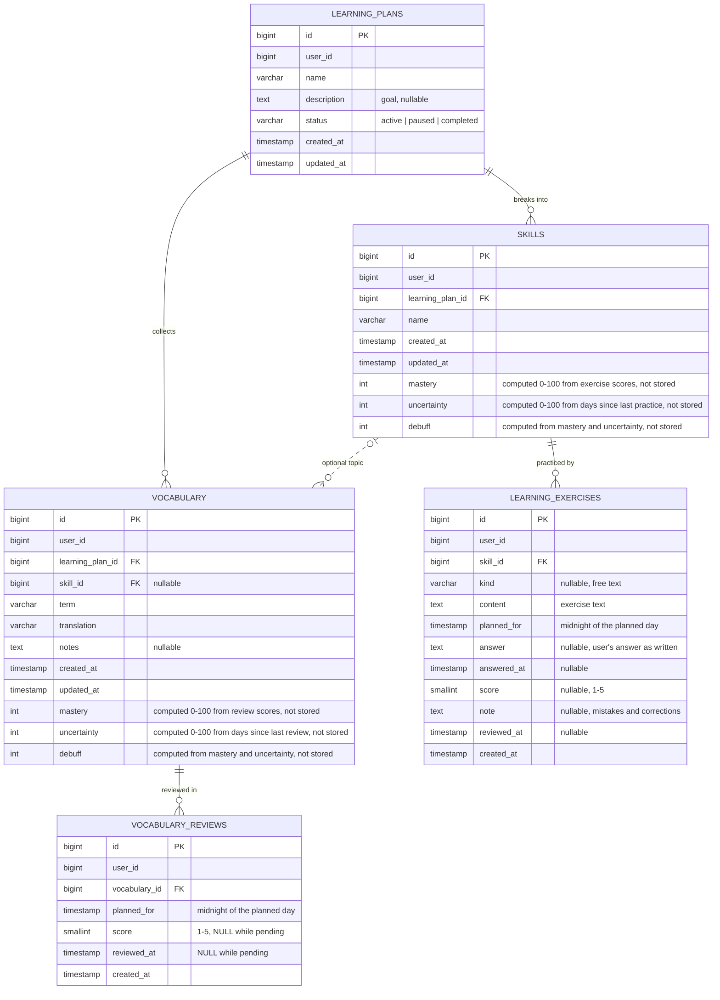
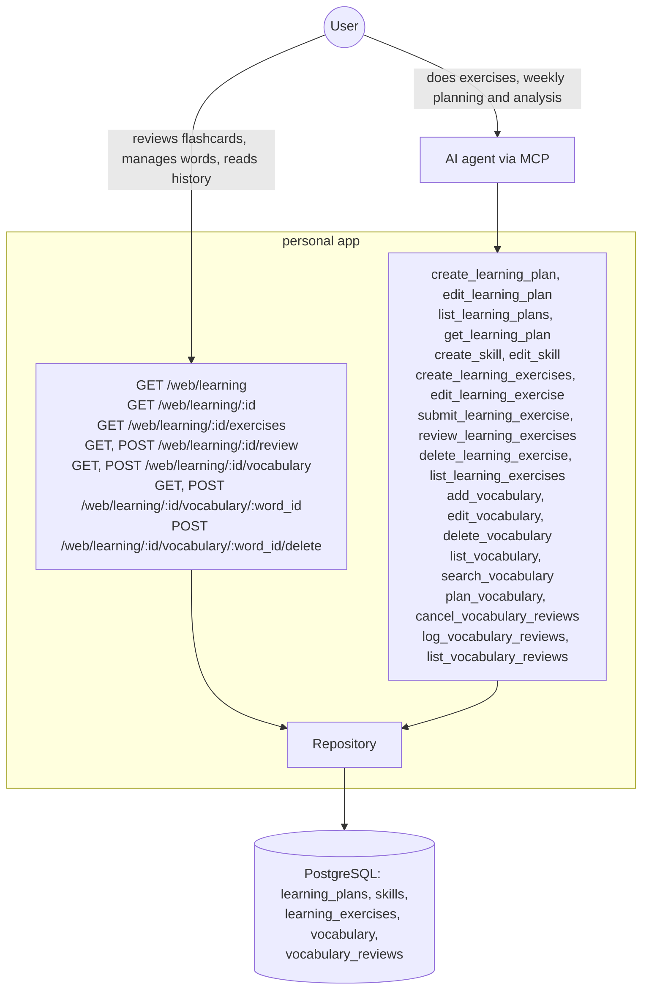

# Learning - Complete Specification

## Overview

Structured tracking of long-running study. First two plans: learning Greek (vocabulary-heavy) and learning Kubernetes (practice-heavy). A plan uses only the parts it needs: a plan without words simply has no vocabulary.

The work runs in a weekly cycle:

1. **Plan**: the agent reads the week's answers, review results and mastery, then creates the exercises for the next week and plans word reviews by day, both for first contact and for repetition.
2. **Do**: each day the user does the exercises due that day in chat with the agent and reviews the words due that day on the web.
3. **Analyze**: at the end of the week the agent checks the answers, gives each a score and a note, and the cycle starts again. A word used in an exercise counts as partly repeated, and a skill built on another shows that one still holds. The agent weighs this when planning, the system does not model it.

Entities:

- **Learning plan**: the course or track being followed, e.g. "Greek A1", with a status.
- **Skill**: a topic inside a plan, e.g. "present tense", "pods & deployments".
- **Learning exercise**: one exercise from creation to review. Created ahead with its full text, its optional kind and the day it is planned for. It then gets the user's answer, and later the agent's score (1-5) and note. A task with several sentences is one entry with one score. Kind is free text, e.g. "put into the correct form", "choose the ending", "translate RU→EL", "kubectl". Reviewing a skill means planning another exercise for it, so skills have no dates of their own.
- **Vocabulary word**: a term with its translation.
- **Vocabulary review**: one check of a word with a score 1-5, the same scale as exercises. It is either planned on a day and scored on a flashcard, or logged by the agent after the fact when the word showed up in an exercise answer. Reviews are never overwritten, so they form the word's full history. A review without a score is pending.

Flashcard buttons and their scores:

| Button | Meaning | Score |
|---|---|---|
| «Recalled» | Recalled the translation without a hint | 5 |
| «With a hint» | Recalled it only with a hint, e.g. the skill or a first letter | 3 |
| «Couldn't recall» | Did not recall it | 2 |
| «Wrong / guessed» | Answered wrongly or tried to guess | 1 |

For a word in an exercise answer the agent picks any score 1-5, by how well it was used.

**Mastery** is a percentage, 0-100, of a skill and of a word; 80% and above means confidently mastered. It is computed at read time, never stored or set by hand, with one formula for both: start at 0%, then walk the scores oldest first, adding each score's step and keeping the value within 0-100.

| Score | 5 | 4 | 3 | 2 | 1 |
|---|---|---|---|---|---|
| Step | +20 | +10 | 0 | −10 | −20 |

A skill's scores come from its reviewed exercises, a word's from its scored reviews; unscored ones do not count. So four perfect results in a row reach 80%. Changing the steps later recomputes every mastery from the same history.

**Uncertainty** grows with the time since the last practice and applies a **debuff** to mastery. Both are computed at read time against now, with one formula for skills and words:

```
S         = 3 + 0.6 × mastery          stability in days: strong items are forgotten slower
U         = t / (t + S)                t = days since the last practice; 0 right after it, 50% after S days
debuff    = mastery × U × 0.5          at most half of mastery is lost after a very long pause
effective = mastery − debuff
```

Last practice is the latest scored review for a word (flashcard or indirect) and the latest answered exercise for a skill; any result resets `U` to 0, a bad one included, since mastery already took it into account. With no practice, `U` is 100% and the debuff is 0.

| Item | Mastery | Without practice | U | Shown as |
|---|---|---|---|---|
| Word | 80% | 2 weeks | 22% | 80% (−9%), uncertainty 22% |
| Word | 80% | 51 days | 50% | 80% (−20%), uncertainty 50% |
| Word | 80% | half a year | 78% | 80% (−31%), uncertainty 78% |
| Word | 20% | 2 weeks | 48% | 20% (−5%), uncertainty 48% |

Effective mastery is what counts as "mastered" (≥80%) in plan stats and what `max_mastery` filters by, so a word mastered long ago comes back as a review candidate.

Exercise state is computed from its fields: `planned` (no answer), `answered` (answer, no score), `reviewed` (score).

Where each part happens:

- **Exercises: only in chat.** The agent gives the due exercise, the user answers, often handwritten on paper and sent as a photo, and the agent saves the recognized answer word for word. The web only shows them, read-only: planned ones and the history.
- **Word reviews: only on the web**, as flashcards. The agent plans them and reads the results, but does not run them. The only reviews the agent writes are scores for words it finds in exercise answers.
- **Vocabulary management**: both on the web (list, search, add, edit, delete) and through MCP.
- Plans, skills, planning and scoring are done only through MCP.

Plans and skills are never deleted in this version: a plan leaves the default list through its status. Learning has no link to activities or achievements.

## Architecture Diagrams

### Entity Relation Diagram



### C4 Context Diagram



## Database Schema

### SQL DDL

```sql
-- gateways/db/migrations/learning.sql
CREATE TABLE IF NOT EXISTS learning_plans (
    id BIGSERIAL PRIMARY KEY,
    user_id BIGINT NOT NULL,
    name VARCHAR(255) NOT NULL,
    description TEXT,
    status VARCHAR(20) NOT NULL DEFAULT 'active' CHECK (status IN ('active', 'paused', 'completed')),
    created_at TIMESTAMPTZ NOT NULL DEFAULT CURRENT_TIMESTAMP,
    updated_at TIMESTAMPTZ NOT NULL DEFAULT CURRENT_TIMESTAMP
);

CREATE TABLE IF NOT EXISTS skills (
    id BIGSERIAL PRIMARY KEY,
    user_id BIGINT NOT NULL,
    learning_plan_id BIGINT NOT NULL REFERENCES learning_plans(id),
    name VARCHAR(255) NOT NULL,
    created_at TIMESTAMPTZ NOT NULL DEFAULT CURRENT_TIMESTAMP,
    updated_at TIMESTAMPTZ NOT NULL DEFAULT CURRENT_TIMESTAMP
);

CREATE TABLE IF NOT EXISTS learning_exercises (
    id BIGSERIAL PRIMARY KEY,
    user_id BIGINT NOT NULL,
    skill_id BIGINT NOT NULL REFERENCES skills(id),
    kind VARCHAR(100),
    content TEXT NOT NULL,
    planned_for TIMESTAMPTZ NOT NULL,
    answer TEXT,
    answered_at TIMESTAMPTZ,
    score SMALLINT,
    note TEXT,
    reviewed_at TIMESTAMPTZ,
    created_at TIMESTAMPTZ NOT NULL DEFAULT CURRENT_TIMESTAMP
);

CREATE TABLE IF NOT EXISTS vocabulary (
    id BIGSERIAL PRIMARY KEY,
    user_id BIGINT NOT NULL,
    learning_plan_id BIGINT NOT NULL REFERENCES learning_plans(id),
    skill_id BIGINT REFERENCES skills(id),
    term VARCHAR(255) NOT NULL,
    translation VARCHAR(255) NOT NULL,
    notes TEXT,
    created_at TIMESTAMPTZ NOT NULL DEFAULT CURRENT_TIMESTAMP,
    updated_at TIMESTAMPTZ NOT NULL DEFAULT CURRENT_TIMESTAMP
);

CREATE TABLE IF NOT EXISTS vocabulary_reviews (
    id BIGSERIAL PRIMARY KEY,
    user_id BIGINT NOT NULL,
    vocabulary_id BIGINT NOT NULL REFERENCES vocabulary(id) ON DELETE CASCADE,
    planned_for TIMESTAMPTZ NOT NULL,
    score SMALLINT,
    reviewed_at TIMESTAMPTZ,
    created_at TIMESTAMPTZ NOT NULL DEFAULT CURRENT_TIMESTAMP
);
```

## Go Code Structure

### Domain Models

```go
// domain/learning.go

type LearningPlanStatus string

const (
    LearningPlanActive    LearningPlanStatus = "active"
    LearningPlanPaused    LearningPlanStatus = "paused"
    LearningPlanCompleted LearningPlanStatus = "completed"
)

// LearningExerciseState is computed from an exercise's fields
type LearningExerciseState string

const (
    LearningExercisePlanned  LearningExerciseState = "planned"
    LearningExerciseAnswered LearningExerciseState = "answered"
    LearningExerciseReviewed LearningExerciseState = "reviewed"
)

// MasterySteps is the mastery change of each score 1-5
var MasterySteps = map[int]int{5: 20, 4: 10, 3: 0, 2: -10, 1: -20}

// FlashcardScores are the scores the web flashcard buttons post
var FlashcardScores = []int{5, 3, 2, 1}

type LearningPlan struct {
    ID          int64              `json:"id" db:"id"`
    UserID      int64              `json:"-" db:"user_id"`
    Name        string             `json:"name" db:"name"`
    Description *string            `json:"description,omitempty" db:"description" jsonschema:"Goal of the plan"`
    Status      LearningPlanStatus `json:"status" db:"status" jsonschema:"active, paused or completed"`
    CreatedAt   time.Time          `json:"created_at" db:"created_at"`
    UpdatedAt   time.Time          `json:"updated_at" db:"updated_at"`
}

type Skill struct {
    ID             int64     `json:"id" db:"id"`
    UserID         int64     `json:"-" db:"user_id"`
    LearningPlanID int64     `json:"learning_plan_id" db:"learning_plan_id"`
    Name           string    `json:"name" db:"name"`
    CreatedAt      time.Time `json:"created_at" db:"created_at"`
    UpdatedAt      time.Time `json:"updated_at" db:"updated_at"`
    // Read-only, computed by ListSkills from learning_exercises
    AnsweredCount   int        `json:"answered_count" db:"answered_count"`
    PlannedCount    int        `json:"planned_count" db:"planned_count"`
    LastPracticedAt *time.Time `json:"last_practiced_at,omitempty" db:"last_practiced_at"`
    LastScore       *int       `json:"last_score,omitempty" db:"last_score"`
    Scores          []int      `json:"-" db:"scores"` // reviewed scores, oldest first
    // Computed in the action layer by ComputeMastery(Scores, LastPracticedAt, now)
    MasteryState
}

type LearningExercise struct {
    ID         int64      `json:"id" db:"id"`
    UserID     int64      `json:"-" db:"user_id"`
    SkillID    int64      `json:"skill_id" db:"skill_id"`
    Kind       *string    `json:"kind,omitempty" db:"kind" jsonschema:"Free-text kind of exercise, e.g. translate RU→EL"`
    Content    string     `json:"content" db:"content" jsonschema:"Full exercise text"`
    PlannedFor time.Time  `json:"planned_for" db:"planned_for"`
    Answer     *string    `json:"answer,omitempty" db:"answer" jsonschema:"The user's answer as written, recognized word for word from handwriting when sent as a photo, not corrected"`
    AnsweredAt *time.Time `json:"answered_at,omitempty" db:"answered_at"`
    Score      *int       `json:"score,omitempty" db:"score" jsonschema:"How it went, 1-5"`
    Note       *string    `json:"note,omitempty" db:"note" jsonschema:"Mistakes and corrections"`
    ReviewedAt *time.Time `json:"reviewed_at,omitempty" db:"reviewed_at"`
    CreatedAt  time.Time  `json:"created_at" db:"created_at"`
    // Read-only, joined from skills
    SkillName string `json:"skill_name" db:"skill_name"`
}

type VocabularyWord struct {
    ID             int64     `json:"id" db:"id"`
    UserID         int64     `json:"-" db:"user_id"`
    LearningPlanID int64     `json:"learning_plan_id" db:"learning_plan_id"`
    SkillID        *int64    `json:"skill_id,omitempty" db:"skill_id"`
    Term           string    `json:"term" db:"term"`
    Translation    string    `json:"translation" db:"translation"`
    Notes          *string   `json:"notes,omitempty" db:"notes"`
    CreatedAt      time.Time `json:"created_at" db:"created_at"`
    UpdatedAt      time.Time `json:"updated_at" db:"updated_at"`
    // Read-only, computed from vocabulary_reviews
    ReviewCount    int        `json:"review_count" db:"review_count" jsonschema:"Scored reviews"`
    LastReviewedAt *time.Time `json:"last_reviewed_at,omitempty" db:"last_reviewed_at"`
    LastScore      *int       `json:"last_score,omitempty" db:"last_score"`
    NextPlannedFor *time.Time `json:"next_planned_for,omitempty" db:"next_planned_for" jsonschema:"Earliest pending review"`
    Scores         []int      `json:"-" db:"scores"` // review scores, oldest by reviewed_at first
    // Computed in the action layer by ComputeMastery(Scores, LastReviewedAt, now)
    MasteryState
}

type VocabularyReview struct {
    ID           int64      `json:"id" db:"id"`
    UserID       int64      `json:"-" db:"user_id"`
    VocabularyID int64      `json:"vocabulary_id" db:"vocabulary_id"`
    PlannedFor   time.Time  `json:"planned_for" db:"planned_for"`
    Score        *int       `json:"score,omitempty" db:"score" jsonschema:"1-5; empty while pending"`
    ReviewedAt   *time.Time `json:"reviewed_at,omitempty" db:"reviewed_at"`
    CreatedAt    time.Time  `json:"created_at" db:"created_at"`
    // Read-only, joined from vocabulary
    Term        string  `json:"term" db:"term"`
    Translation string  `json:"translation" db:"translation"`
    Notes       *string `json:"notes,omitempty" db:"notes"`
}

// MasteryState is computed at read time, never stored; shared by skills and words
type MasteryState struct {
    Mastery          int `json:"mastery" db:"-" jsonschema:"Mastery percentage from the score history, 0-100"`
    Uncertainty      int `json:"uncertainty" db:"-" jsonschema:"Percentage, 0-100, growing with days since the last practice"`
    Debuff           int `json:"debuff" db:"-" jsonschema:"Points taken off mastery because of uncertainty"`
    EffectiveMastery int `json:"effective_mastery" db:"-" jsonschema:"mastery - debuff; 80+ is confidently mastered"`
}

// ComputeMastery folds scores, oldest first, with MasterySteps into mastery, then applies
// uncertainty from the days between lastPracticedAt and now; nil lastPracticedAt = 100% uncertainty
func ComputeMastery(scores []int, lastPracticedAt *time.Time, now time.Time) MasteryState

// VocabularyStats is a per-plan summary, computed by the action from the plan's words
type VocabularyStats struct {
    LearningPlanID int64
    Total          int
    Due            int // pending reviews whose day has come
    Unscheduled    int // words with no pending review
    Mastered       int // words with effective mastery >= 80
    AverageMastery int // average effective mastery
}

// LearningExerciseStats is a per-plan summary, computed at read time
type LearningExerciseStats struct {
    LearningPlanID int64
    Planned        int // all without an answer
    Due            int // planned, day has come
    AwaitingReview int // answered, no score yet
}

type LearningPlanFilter struct {
    UserID   int64
    Statuses []LearningPlanStatus // empty = active and paused
}

type LearningExerciseFilter struct {
    UserID         int64
    LearningPlanID *int64
    SkillID        *int64
    States         []LearningExerciseState // empty = every state
    DueAt          *time.Time              // planned_for <= DueAt
    OldestFirst    bool                    // planned_for ASC, id ASC; default planned_for DESC, id DESC
    Limit          int
    Offset         int
}

type VocabularyFilter struct {
    UserID             int64
    LearningPlanID     *int64
    IDs                []int64
    Unscheduled        bool // no pending review
    LeastRecentlyFirst bool // last reviewed ASC NULLS FIRST, then id ASC; default created_at DESC, then id DESC
    Limit              int  // 0 = no limit
    Offset             int
}

// VocabularySearchFilter is a single-variant search; the action merges variants and counts match_count
type VocabularySearchFilter struct {
    UserID         int64
    Query          string // ILIKE substring on term, translation and notes
    LearningPlanID *int64
}

type VocabularyReviewFilter struct {
    UserID         int64
    LearningPlanID *int64
    VocabularyID   *int64
    IDs            []int64
    Pending        *bool      // true = no score yet, false = scored
    DueAt          *time.Time // planned_for <= DueAt; ordered by planned_for ASC, then id ASC
    ReviewedFrom   *time.Time // reviewed_at >= ReviewedFrom
    ReviewedTo     *time.Time // reviewed_at < ReviewedTo
    Limit          int        // 0 = no limit; default order reviewed_at DESC NULLS LAST, planned_for ASC
    Offset         int
}

// LearningExerciseReview is the agent's result for one answered exercise
type LearningExerciseReview struct {
    ExerciseID int64
    Score      int
    Note       *string
    ReviewedAt time.Time
}
```

### Repository Interface

```go
// Learning plans
CreateLearningPlan(ctx context.Context, plan *domain.LearningPlan) (int64, error)
GetLearningPlan(ctx context.Context, planID int64, userID int64) (*domain.LearningPlan, error)
ListLearningPlans(ctx context.Context, filter domain.LearningPlanFilter) ([]domain.LearningPlan, error) // active first, then paused, then completed; newest first inside a status
UpdateLearningPlan(ctx context.Context, plan *domain.LearningPlan) error

// Skills
CreateSkill(ctx context.Context, skill *domain.Skill) (int64, error)
GetSkill(ctx context.Context, skillID int64, userID int64) (*domain.Skill, error)
ListSkills(ctx context.Context, planID int64, userID int64) ([]domain.Skill, error) // one query: fills read-only fields, Scores via ARRAY_AGG(score ORDER BY reviewed_at) grouped by skill; ordered by created_at ASC
UpdateSkill(ctx context.Context, skill *domain.Skill) error

// Learning exercises
CreateLearningExercises(ctx context.Context, exercises []domain.LearningExercise) ([]int64, error) // one transaction
GetLearningExercise(ctx context.Context, exerciseID int64, userID int64) (*domain.LearningExercise, error)
ListLearningExercises(ctx context.Context, filter domain.LearningExerciseFilter) ([]domain.LearningExercise, error)
CountLearningExercises(ctx context.Context, filter domain.LearningExerciseFilter) (int, error) // ignores Limit and Offset
GetLearningExerciseStats(ctx context.Context, userID int64, planIDs []int64, dueAt time.Time) ([]domain.LearningExerciseStats, error)
UpdateLearningExercise(ctx context.Context, exercise *domain.LearningExercise) error // kind, content, planned_for
SubmitLearningExerciseAnswer(ctx context.Context, exerciseID int64, userID int64, answer string, answeredAt time.Time) error
ReviewLearningExercises(ctx context.Context, userID int64, reviews []domain.LearningExerciseReview) error // one transaction
DeleteLearningExercise(ctx context.Context, exerciseID int64, userID int64) error

// Vocabulary
CreateVocabulary(ctx context.Context, words []domain.VocabularyWord) ([]int64, error) // one transaction
ListVocabulary(ctx context.Context, filter domain.VocabularyFilter) ([]domain.VocabularyWord, error) // one query: fills read-only fields, Scores via ARRAY_AGG(score ORDER BY reviewed_at) grouped by word
CountVocabulary(ctx context.Context, filter domain.VocabularyFilter) (int, error) // ignores Limit and Offset
SearchVocabulary(ctx context.Context, filter domain.VocabularySearchFilter) ([]domain.VocabularyWord, error) // one query, same read-only fields and Scores as ListVocabulary
FindVocabularyTerms(ctx context.Context, planID int64, userID int64, terms []string) ([]string, error) // case-insensitive; returns terms already in the plan
CountDueVocabularyReviews(ctx context.Context, userID int64, planIDs []int64, dueAt time.Time) (map[int64]int, error) // per plan
UpdateVocabulary(ctx context.Context, word *domain.VocabularyWord) error // term, translation, notes, skill
DeleteVocabulary(ctx context.Context, wordID int64, userID int64) error // its reviews go with it

// Vocabulary reviews
CreateVocabularyReviews(ctx context.Context, reviews []domain.VocabularyReview) ([]int64, error) // one transaction; pending ones from plan_vocabulary, done ones from log_vocabulary_reviews
ListVocabularyReviews(ctx context.Context, filter domain.VocabularyReviewFilter) ([]domain.VocabularyReview, error)
CountVocabularyReviews(ctx context.Context, filter domain.VocabularyReviewFilter) (int, error) // ignores Limit and Offset
RecordVocabularyReview(ctx context.Context, reviewID int64, userID int64, score int, reviewedAt time.Time) error // pending only
DeleteVocabularyReviews(ctx context.Context, userID int64, reviewIDs []int64) error // one transaction; pending only
```

## MCP Tools

### create_learning_plan
Creates a plan in `active` with a name and an optional description.

### edit_learning_plan
Partial update of name, description and status. Any status can change to any other.

### list_learning_plans
Lists plans with optional `statuses` (default: `active` and `paused`). Each plan includes its skill count, exercise stats and vocabulary stats.

### get_learning_plan
Returns one plan with its skills (mastery, uncertainty, debuff and effective mastery, answered and planned exercises, last practiced date, last score), exercise stats (planned, due, awaiting review) and vocabulary stats (total, due, unscheduled, mastered, average mastery).

### create_skill
Adds a skill to a plan. The name must be unique inside the plan, ignoring case.

### edit_skill
Renames a skill.

### create_learning_exercises
Creates 1-50 planned exercises for the coming days: skill, full text, optional kind and planned day. The day cannot be in the past. All or nothing.

### edit_learning_exercise
Partial update of kind, text and planned day of an exercise with no answer yet, also used to move a missed exercise to another day. Fails once it is answered.

### submit_learning_exercise
Saves the user's answer given in chat. When the answer is a photo of handwriting, the agent saves the recognized text word for word, mistakes included. Fails on an empty answer or an exercise that already has one.

### review_learning_exercises
Saves the weekly analysis: 1-50 results of `exercise_id`, score 1-5 and optional note. Fails on an exercise with no answer. A reviewed exercise can be reviewed again to correct it. All or nothing. The skill's mastery follows from the scores.

### delete_learning_exercise
Deletes one exercise by id in any state, returning what was deleted.

### list_learning_exercises
Exercises with full text and skill names, for a `skill_id` or a `learning_plan_id`, exactly one of them. Optional `states` and `due_only` (planned day has come). Newest planned day first, or earliest first when `states` is only `planned`. Paginated via `limit` (default 20) and `offset`. Used both to give today's exercises in chat and for the weekly analysis.

### add_vocabulary
Adds 1-50 words to a plan: term, translation, optional notes and skill (must belong to the plan). A new word has 0% mastery and no reviews. All or nothing: a term already in the plan or repeated in the call fails the whole call, and the error lists those terms.

### edit_vocabulary
Partial update of term, translation, notes and skill. `notes: ""` clears the notes and `skill_id: 0` clears the skill. Reviews are untouched.

### delete_vocabulary
Deletes one word by id together with its reviews, returning what was deleted.

### list_vocabulary
Words of a plan with mastery, uncertainty, debuff, effective mastery and computed review fields (scored review count, last review and its score, next planned day), least recently reviewed first, never reviewed on top. Optional `max_mastery` on effective mastery (e.g. 79 for words not mastered or slipping) and `unscheduled` (no pending review). Paginated via `limit` (default 50) and `offset`. With `max_mastery` the action loads all words of the plan in one query, filters by mastery, then pages, since mastery is not in SQL.

### search_vocabulary
Finds words by 1-5 `query_variants` in term, translation and notes, optionally inside one plan. Standard text search ranking. Returns the same mastery and computed review fields as `list_vocabulary`.

### plan_vocabulary
Plans word reviews: 1-100 entries of `word_id` and `review_dates`, one pending review per date. A date in the past, or a word that already has a pending review on that day, fails. All or nothing.

### cancel_vocabulary_reviews
Deletes 1-100 pending reviews by id, e.g. missed reviews the agent replans. A review with a result cannot be deleted. All or nothing.

### log_vocabulary_reviews
Records indirect reviews found at the weekly analysis: 1-100 entries of `word_id` and `score` 1-5, by how well the word was used in an exercise answer, each a scored review dated today. A score outside 1-5, an unknown or another user's word fails. All or nothing. Pending reviews of those words are untouched.

### list_vocabulary_reviews
Reviews of a plan with term and translation, for the weekly analysis: scored reviews in a `reviewed_from` / `reviewed_to` window (newest first), or pending ones with `pending: true` (earliest first). Optional `vocabulary_id` returns one word's full history. Paginated via `limit` (default 100) and `offset`.

## HTTP Handlers

### GET /web/learning
Table of plans, one row per plan, linking to its page: name, status, skills, exercises due, words due. Uses `?status=` to show plans with one status; the default shows `active` and `paused`. Nav item «Learning».

### GET /web/learning/:id
Plan page: description, then stat tiles for exercises (due, awaiting review), then a skills table (name, mastery shown as `80% (−20%)`, uncertainty %, answered, planned, last practiced, last score) whose rows link to the skill's exercise history. «Vocabulary» and «Exercises» links are always shown, so the first word can be added from the web. When the plan has words, stat tiles show total, due, unscheduled, mastered and average mastery, with a «Review N words» link. 404 for a missing or foreign plan.

### GET /web/learning/:id/exercises
Exercises of a plan, or of one skill with `?skill_id=N`, read-only, in two sections. «Planned»: every exercise without an answer, earliest planned day first, not paginated; each card shows skill, kind, planned day with «Missed» when the day has passed or «Today», and the full `content` with line breaks kept. «History»: answered exercises, newest planned day first, paginated with `?page=N`; each card shows skill, kind, answer date, score or «Not reviewed», then the full `content`, `answer` and `note` with line breaks kept. Each section has its own empty state. A link leads back to the plan. 404 for a missing or foreign plan, or a skill outside the plan.

### GET /web/learning/:id/review
Shows the earliest due pending review as a card: the term, with the number of reviews left. The translation, notes and the «Recalled», «With a hint», «Couldn't recall» and «Wrong / guessed» buttons (scores 5, 3, 2, 1) sit in a `<details>` element, so the answer opens without JS. Each due review is its own card, so a word with a missed review and today's review is shown twice. With nothing due, shows an empty state and a link back to the plan. 404 for a missing or foreign plan.

### POST /web/learning/:id/review
Records the posted score on the posted review, then redirects `303` to `GET /web/learning/:id/review`. A review that already has a result, for example after a double submit, or is not due yet, or a score outside the flashcard ones, re-renders the page with an inline error and changes nothing. 404 for a missing or foreign plan, or a review of a word outside the plan.

### GET /web/learning/:id/vocabulary
Vocabulary of one plan: a form to add a word (term, translation, notes, skill dropdown), a search input (`q`, comma-separated phrases), then a paginated table (`?page=N`): term, translation, notes, skill, mastery shown as `80% (−20%)`, uncertainty %, last score, next review. Rows link to the edit page. Without `q`, newest words first. With `q`, the same search as `search_vocabulary` inside this plan, and more than 5 phrases shows an inline error. A link leads back to the plan. 404 for a missing or foreign plan.

### POST /web/learning/:id/vocabulary
Adds one word through the same validation and repository calls as `add_vocabulary`, then redirects `303` to `GET /web/learning/:id/vocabulary`. On a validation error, including a term already in the plan, re-renders the page with an inline error and the typed values, and creates nothing. 404 for a missing or foreign plan.

### GET /web/learning/:id/vocabulary/:word_id
Edit page of one word: form with term, translation, notes and skill dropdown (with a «No skill» item), read-only mastery with its debuff and uncertainty, then the word's review history (planned day, score, review date), newest first, and a delete button inside `<details>` to guard against a misclick. 404 for a missing or foreign plan, or a word outside the plan.

### POST /web/learning/:id/vocabulary/:word_id
Saves the form through the same validation and repository calls as `edit_vocabulary`: empty notes and «No skill» clear those fields. Redirects `303` to `GET /web/learning/:id/vocabulary`. On a validation error re-renders the edit page with an inline error and changes nothing. 404 as on the edit page.

### POST /web/learning/:id/vocabulary/:word_id/delete
Deletes the word and its reviews through the same repository call as `delete_vocabulary`, then redirects `303` to `GET /web/learning/:id/vocabulary`. 404 as on the edit page.

## Configuration

- **Display timezone**: `Asia/Nicosia`; planned days of exercises and reviews are stored as midnight of that day
- **Mastery**: starts at 0, kept within 0-100; 80 = confidently mastered
- **Mastery steps** (skills and words): score 5 → +20, 4 → +10, 3 → 0, 2 → −10, 1 → −20
- **Stability**: `S = 3 + 0.6 × mastery` days (3 at 0%, 51 at 80%, 63 at 100%)
- **Debuff factor**: 0.5, the share of mastery lost at 100% uncertainty
- **Flashcard scores**: «Recalled» 5, «With a hint» 3, «Couldn't recall» 2, «Wrong / guessed» 1
- **list_learning_exercises limit**: default 20
- **list_vocabulary limit**: default 50
- **list_vocabulary_reviews limit**: default 100
- **Batch size**: at most 50 entries in `create_learning_exercises`, `review_learning_exercises` and `add_vocabulary`; at most 100 in `plan_vocabulary`, `cancel_vocabulary_reviews` and `log_vocabulary_reviews`
- **Web vocabulary page size**: 50 words
- **Web exercise history page size**: 20 entries

## E2E Tests

`tests/learning_plans_test.go`:

- `TestCreateLearningPlan`: created as `active`; empty name fails
- `TestEditLearningPlan`: each field alone; status change; no fields fails; invalid status fails; another user's plan fails
- `TestListLearningPlans`: default hides `completed`; `statuses` filter; skill count, exercise stats and vocabulary stats filled; other user's plans not returned
- `TestGetLearningPlan`: skills with mastery, answered and planned counts, last practiced date and last score; exercise stats; vocabulary stats with due, unscheduled, mastered and average mastery; plan without words or skills; another user's plan fails

`tests/learning_skills_test.go`:

- `TestCreateSkill`: created with 0% mastery; duplicate name in another case fails; same name in another plan succeeds; empty name fails; another user's plan fails
- `TestEditSkill`: renames; empty name fails; duplicate name fails; another user's skill fails
- `TestSkillMastery`: scores 5, 5, 5, 5 → 80; 5 then 1 → 0; 1 at 0% stays 0; six 5s stay at 100; score 3 changes nothing; answered but unreviewed exercises not counted; re-reviewing an exercise recomputes with the new score; uncertainty counted from the latest answered exercise

`tests/learning_exercises_test.go`:

- `TestCreateLearningExercises`: several exercises saved as `planned` with multi-line text kept word for word; planned day stored as midnight `Asia/Nicosia`; without kind; empty content, past day, 0 or more than 50 entries and another user's skill create nothing
- `TestEditLearningExercise`: each field alone; moves a missed exercise to a later day; no fields fails; answered exercise fails; another user's exercise fails
- `TestSubmitLearningExercise`: answer stored word for word with `answered_at`; state becomes `answered`; empty answer fails; second answer fails and keeps the first; another user's exercise fails
- `TestReviewLearningExercises`: score and note saved, state becomes `reviewed`; several in one call; second review overwrites; score outside 1-5, unanswered exercise, 0 or more than 50 entries and another user's exercise change nothing in the whole call
- `TestDeleteLearningExercise`: deleted and returned in each state; unknown id fails; another user's exercise fails
- `TestListLearningExercises`: by skill; by plan; `states` filter; `due_only` hides future days; newest first; earliest first for `planned` only; full text returned; limit and offset; both or neither of `skill_id` and `learning_plan_id` fails; other user's exercises not returned

`tests/learning_vocabulary_test.go`:

- `TestAddVocabulary`: new word has 0% mastery and no reviews; several words in one call; term already in the plan or repeated in the call, any case, adds nothing and lists the terms; same term in another plan succeeds; skill of another plan fails; empty term or translation fails; 0 or more than 50 words fails; another user's plan fails
- `TestEditVocabulary`: each field alone; `notes: ""` and `skill_id: 0` clear those fields; reviews unchanged; no fields fails; duplicate term fails; skill of another plan fails; another user's word fails
- `TestDeleteVocabulary`: word and its reviews deleted and returned; unknown id fails; another user's word fails
- `TestListVocabulary`: never reviewed first, then least recently reviewed; mastery, scored review count, last score and next planned day computed from reviews; `max_mastery` filter; `unscheduled` filter; limit and offset; other user's words not returned
- `TestSearchVocabulary`: matches term, translation and notes, ignoring case; ranked by `match_count`, then newest first; plan filter; mastery and review fields returned; 0 or more than 5 variants or an empty variant fails; other user's words not returned
- `TestWordMastery`: four 5s → 80; 5 then 1 → 0; 2 at 0% stays 0; 3 changes nothing; six 5s stay at 100; pending reviews not counted; flashcard and indirect scores counted together in `reviewed_at` order
- `TestMasteryUncertainty`: mastery 80 reviewed today → uncertainty 0, debuff 0; 14 days ago → uncertainty 22, debuff 9, effective 71; 51 days ago → uncertainty 50, debuff 20; mastery 20, 14 days ago → uncertainty 48, debuff 5; no practice → uncertainty 100, debuff 0; an indirect review resets uncertainty; a word at 80% after 51 days is not counted as mastered and is returned by `max_mastery: 79`

`tests/learning_vocabulary_reviews_test.go`:

- `TestPlanVocabulary`: one and several review dates create pending reviews at midnight `Asia/Nicosia`; several words in one call; a scored review on that day does not block planning; no dates, a past date, a word with a pending review on that day, an unknown or another user's word, 0 or more than 100 entries change nothing in the whole call
- `TestCancelVocabularyReviews`: pending reviews deleted; a review with a result, an unknown or another user's review, 0 or more than 100 ids delete nothing in the whole call
- `TestLogVocabularyReviews`: scores 4 and 2 create scored reviews dated today and move mastery by +10 / −10; pending reviews of the word untouched; a score outside 1-5, an unknown or another user's word, 0 or more than 100 entries create nothing in the whole call
- `TestListVocabularyReviews`: scored reviews in a `reviewed_from` / `reviewed_to` window, newest first; `pending: true` earliest first; `vocabulary_id` returns one word's full history; term and translation joined; limit and offset; other user's reviews not returned

`tests/learning_web_test.go`:

- `TestLearningWeb_PlanList`: default hides `completed`; `?status=` filter; due counts for exercises and words; rows link to plan pages; empty state; other user's plans not shown
- `TestLearningWeb_PlanPage`: skills table with mastery as `80% (−20%)` and uncertainty, and rows linking to skill history; vocabulary and exercises links always shown; exercise tiles; plan with words shows word tiles with mastered count and average mastery, and the review link; plan without words shows no word tiles; missing or foreign plan 404s
- `TestLearningWeb_ExerciseHistory`: planned section shows exercises without an answer, earliest first, with full content, kind and planned day, «Missed» for a past day and «Today» for today, and not in the history; history shows answered exercises of all its skills, newest first, with full content, answer, note, kind and score; unreviewed one shows «Not reviewed»; `?skill_id=N` filters both sections to one skill; 21 history entries split into two pages while the planned section stays on every page; another plan's and another user's entries not shown; empty state of each section; skill outside the plan and missing or foreign plan 404
- `TestLearningWeb_Review`: shows the earliest due pending review with the number left and the answer and four buttons inside `<details>`; future and done reviews hidden; a word with two due reviews counts twice; empty state when nothing is due; missing or foreign plan 404s
- `TestLearningWeb_ReviewSubmit`: each of the four buttons stores its score (5, 3, 2, 1) and date on that review, redirects `303` and moves the word's mastery by +20 / 0 / −10 / −20; earlier reviews of the word kept; score 4 or outside 1-5, a review with a score or not due yet re-renders with an error and changes nothing; review of a word outside the plan, foreign review and foreign plan 404
- `TestLearningWeb_VocabularyList`: newest first; 51 words split into two pages; mastery as `80% (−20%)`, uncertainty, last score and next review shown; rows link to edit pages; another plan's words not shown; empty state; missing or foreign plan 404s
- `TestLearningWeb_VocabularySearch`: two comma-separated phrases match term, translation or notes, ignoring case, ranked by match count; another plan's words not found; more than 5 phrases shows an error
- `TestLearningWeb_VocabularyAdd`: word saved with 0% mastery and no reviews, redirect `303`; with a skill; empty term or translation and a duplicate term re-render with an error and the typed values, creating nothing; skill of another plan fails; foreign plan 404s
- `TestLearningWeb_VocabularyEdit`: page shows the word's values, mastery and review history, newest first; saving changes the fields, keeps reviews, redirects `303`; empty notes and «No skill» clear those fields; empty term and duplicate term re-render with an error, changing nothing; word outside the plan and foreign word 404
- `TestLearningWeb_VocabularyDelete`: word and its reviews deleted, redirect `303`; word outside the plan and foreign word 404, deleting nothing

## Follow-ups after implementation

- Write a database document with the weekly ritual: what the agent reads, how it picks exercises and words, how scores are assigned

## Changelog

- **02-11-26** — initial version: plans, skills, exercises created ahead and scored by the agent, vocabulary with review history, computed mastery with uncertainty debuff; MCP tools, web pages (planned exercises and history, flashcards, vocabulary)
