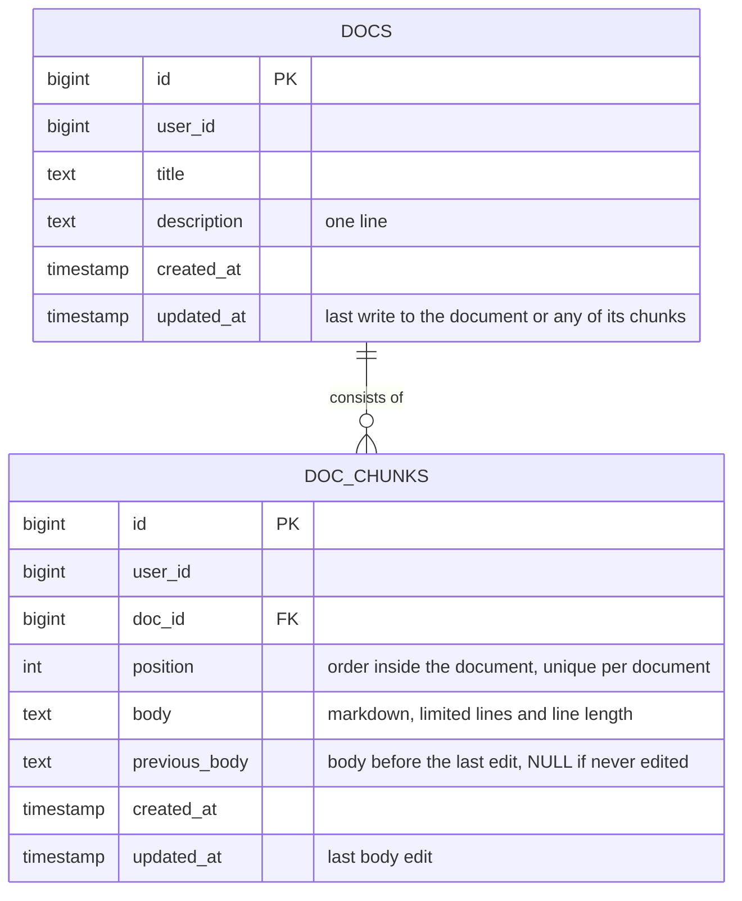
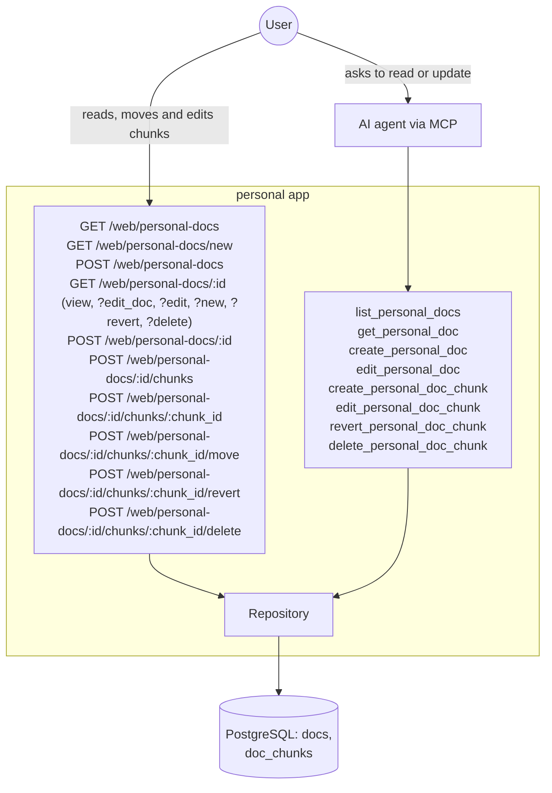

# Personal Docs - Complete Specification

## Overview

New subdomain (`action/personaldocs`) for user-owned markdown documents stored in the database, editable via MCP and the web. First two documents: a personal development plan and personal instructions (how the agent should work with the user).

It is separate from `action/docs` (see `docs-spec.md`), which serves shared convention docs embedded from the repo: those change with a commit and a deploy, personal documents change mid-conversation or from the phone and stay out of git.

- A **document** is a title, a short one-line description (what the document is for, same role as the description of a doc in `list_docs`) and an ordered list of chunks. Both can be edited later. A document is addressed by its numeric id; there is no slug.
- A **chunk** is one section of a document: a markdown body and nothing else (a section heading, if any, is a line of the body). A document is read as its chunks in order, and is edited one chunk at a time, never as a whole.
- A chunk is small by rule: its body has a maximum number of lines and every line has a maximum length (see Configuration). An edit that breaks a limit is rejected, so a section that outgrows the limit is split into two chunks.
- There is no version history, only one step back: an edit overwrites the chunk's body and keeps the replaced text as the chunk's previous body. A revert swaps the body with the previous body, so a second revert brings the edit back. A new chunk has no previous body.
- Positions of a document's chunks are always `1..N` with no gaps and no duplicates. A new chunk is inserted at a position (default: the end): the chunk already there and all following ones move down by one. A position out of range is an error, never silently corrected.
- A chunk can be moved to another position, or deleted. Deletion is hard and irreversible; the following chunks move up.
- A document's `updated_at` is a stored column, not computed (deviation from the common "computed, not stored" rule). It is refreshed by every write to the document: editing its title or description, and every chunk write (create, body edit, move, revert, delete), in the same transaction as that write.

Interfaces:
- **MCP**: `list_personal_docs`, `get_personal_doc`, `create_personal_doc`, `edit_personal_doc`, `create_personal_doc_chunk`, `edit_personal_doc_chunk`, `revert_personal_doc_chunk`, `delete_personal_doc_chunk`.
- **Web**: a list of documents, a create form, and one document page with two modes. View mode shows every chunk rendered (a `mermaid` code block as a diagram), with small icon buttons per chunk (move up, move down, edit) and an «Add chunk» button. Edit mode is the same page where one chosen chunk is replaced by an edit form. Nav item «Personal docs».

Out of scope: version history deeper than one step and diffs, deleting a document, text search, seeding the first two documents (they are created through the tools after deploy).

## Architecture Diagrams

### Entity Relation Diagram



### C4 Context Diagram



## Database Schema

### SQL DDL

```sql
-- gateways/db/migrations/personaldocs.sql
CREATE TABLE IF NOT EXISTS docs (
    id BIGSERIAL PRIMARY KEY,
    user_id BIGINT NOT NULL,
    title TEXT NOT NULL CHECK (title <> ''),
    description TEXT NOT NULL CHECK (description <> ''),
    created_at TIMESTAMP NOT NULL DEFAULT CURRENT_TIMESTAMP,
    -- stored: set by UpdatePersonalDoc and by every chunk write
    updated_at TIMESTAMP NOT NULL DEFAULT CURRENT_TIMESTAMP
);

CREATE INDEX IF NOT EXISTS idx_docs_user_id ON docs(user_id);

CREATE TABLE IF NOT EXISTS doc_chunks (
    id BIGSERIAL PRIMARY KEY,
    user_id BIGINT NOT NULL,
    doc_id BIGINT NOT NULL,
    position INT NOT NULL CHECK (position >= 1),
    body TEXT NOT NULL CHECK (body <> ''),
    previous_body TEXT,
    created_at TIMESTAMP NOT NULL DEFAULT CURRENT_TIMESTAMP,
    updated_at TIMESTAMP NOT NULL DEFAULT CURRENT_TIMESTAMP,

    CONSTRAINT fk_doc_chunk_doc FOREIGN KEY (doc_id) REFERENCES docs(id),
    -- backstop for "no two chunks share a position"; checked at commit, so the shift
    -- and the insert or move inside one transaction may pass through duplicates.
    -- Its index also serves reading a document's chunks in order
    CONSTRAINT uq_doc_chunks_doc_position UNIQUE (doc_id, position) DEFERRABLE INITIALLY DEFERRED
);
```

### Example: Read a Full Document

Two queries, the same two reads the repository does for `get_personal_doc` and `GET /web/personal-docs/{id}`. No rows from the first one means the document is not found; no rows from the second one means it is empty.

```sql
-- GetPersonalDoc: title and description, one row
SELECT id, title, description, created_at, updated_at
FROM docs
WHERE user_id = $1 AND id = $2;

-- ListPersonalDocChunks: every chunk in reading order
SELECT id, position, body, updated_at
FROM doc_chunks
WHERE user_id = $1 AND doc_id = $2
ORDER BY position;
```

## Go Code Structure

### Domain Models

```go
// domain/personal_doc.go

type PersonalDoc struct {
    ID          int64     `json:"id" db:"id"`
    UserID      int64     `json:"-" db:"user_id"`
    Title       string    `json:"title" db:"title"`
    Description string    `json:"description" db:"description" jsonschema:"One-line summary of what the document is for"`
    CreatedAt   time.Time `json:"created_at" db:"created_at"`
    UpdatedAt   time.Time `json:"updated_at" db:"updated_at" jsonschema:"Time of the last write to the document or any of its chunks"`
}

// PersonalDocChunk is one section of a document.
type PersonalDocChunk struct {
    ID         int64      `json:"id" db:"id"`
    UserID     int64      `json:"-" db:"user_id"`
    DocID      int64      `json:"-" db:"doc_id"`
    Position   int        `json:"position" db:"position" jsonschema:"1-based order inside the document"`
    Body       string     `json:"body" db:"body" jsonschema:"Markdown text"`
    PreviousBody *string  `json:"-" db:"previous_body"` // body before the last edit; nil if never edited
    CreatedAt  time.Time  `json:"created_at" db:"created_at"`
    UpdatedAt  time.Time  `json:"updated_at" db:"updated_at" jsonschema:"Time of the last body edit"`
}
```

### Repository Interface

```go
// Personal docs
CreatePersonalDoc(ctx context.Context, doc *domain.PersonalDoc) (int64, error)
GetPersonalDoc(ctx context.Context, docID int64, userID int64) (*domain.PersonalDoc, error) // nil when not found
ListPersonalDocs(ctx context.Context, userID int64) ([]domain.PersonalDoc, error) // ordered by id
UpdatePersonalDoc(ctx context.Context, doc *domain.PersonalDoc) error // title, description, updated_at; caller has already merged the change onto a fetched document

// Every chunk write below also sets docs.updated_at of the chunk's document, in the same transaction
CreatePersonalDocChunk(ctx context.Context, chunk *domain.PersonalDocChunk) (int64, error) // at chunk.Position, or at the end when it is 0; in one transaction first moves the chunks at that position and after it down by one, then inserts the new chunk, so two chunks never share a position
GetPersonalDocChunk(ctx context.Context, chunkID int64, userID int64) (*domain.PersonalDocChunk, error) // nil when not found
ListPersonalDocChunks(ctx context.Context, docID int64, userID int64) ([]domain.PersonalDocChunk, error) // ordered by position
UpdatePersonalDocChunk(ctx context.Context, chunk *domain.PersonalDocChunk) error // body, previous_body, updated_at, position; caller has already merged the change onto a fetched chunk; a new position first shifts the chunks between the old and the new position, then places the chunk, in one transaction
DeletePersonalDocChunk(ctx context.Context, chunkID int64, userID int64) error // hard delete; moves the following chunks of the document up, in one transaction
```

## MCP Tools

### list_personal_docs
No input. Lists the user's documents: id, title, one-line description, `updated_at`. No chunks.

### get_personal_doc
Takes `doc_id` (from `list_personal_docs`). Returns the document's title, description and its chunks in order, each with id, position, body and `updated_at`. Unknown document is an error.

### create_personal_doc
Creates an empty document from `title` and `description` and returns its id. Fails on an empty title or description, or a description that is multi-line or over the max line length.

### edit_personal_doc
Edits the document `doc_id`. Optional `title` and `description`; only provided fields change. Fails when no field is given, when nothing changes, on an empty value, or a description that is multi-line or over the max line length.

### create_personal_doc_chunk
Adds a chunk with `body` to the document `doc_id`. Optional `position` from 1 to the number of chunks + 1 (default: the end); when the position is taken, the chunk there and all following ones move down by one. Fails on an empty body, a body over the chunk limits, or a position out of range.

### edit_personal_doc_chunk
Edits the chunk `chunk_id`. Optional `body` (full replace) or `append_body` (added after a blank line) overwrites the body; the replaced text becomes the previous body. Optional `position` from 1 to the number of chunks moves the chunk, shifting the chunks in between, and keeps both. `body` and `append_body` are mutually exclusive. Fails when no field is given, when nothing changes, on an empty value, when the resulting body is over the chunk limits, or when the position is out of range.

### revert_personal_doc_chunk
Takes `chunk_id`. Swaps the chunk's body with its previous body (one step back; calling it again undoes the revert) and returns the chunk. Fails when the chunk has no previous body.

### delete_personal_doc_chunk
Deletes the chunk `chunk_id` for good; the following chunks move up. Unknown chunk is an error.

## HTTP Handlers

### GET /web/personal-docs
Table of the user's documents: title linking to the document, description, updated date. Link «New document». Nav item «Personal docs».

### GET /web/personal-docs/new
Create form: title and description.

### POST /web/personal-docs
Creates the document with the same validation as `create_personal_doc`, then `303` redirect to `GET /web/personal-docs/{id}`. On an error re-renders the form with the entered values and creates nothing.

### GET /web/personal-docs/{id}
The document page. The mode is a query param, so every mode is a plain URL. `404` for an unknown document.

- **View mode** (no params): the title and description with an «✎» link to `?edit_doc=1`, then every chunk in order, each as a block with the anchor `#chunk-{chunk_id}`: its body rendered from markdown to HTML via `webui.RenderMarkdown` in safe mode (raw HTML dropped, safe links only; a `mermaid` code block is drawn as a diagram, see `webui-spec.md`), and a row of small icon buttons: «↑» move up (not on the first chunk), «↓» move down (not on the last chunk), «✎» edit, «↶» revert (only when the chunk has a previous body), «✕» delete. The move buttons are one-button POST forms and act at once. Edit, revert and delete are links to `?edit=`, `?revert=` and `?delete={chunk_id}#chunk-{chunk_id}`. Below the last chunk: «Add chunk», a link to `?new=1#chunk-new`.
- **Edit mode** (`?edit={chunk_id}`): the same page, but the chosen chunk is shown as a form instead of its rendered body: a textarea with the current body, the chunk limits, «Save» and «Cancel» (link back to view mode). The other chunks look as in view mode.
- **Document edit mode** (`?edit_doc=1`): the same page, but the title and description are shown as a form with «Save» and «Cancel». The chunks look as in view mode.
- **Revert confirmation** (`?revert={chunk_id}`): the same page, the chosen chunk stays rendered and gets a confirmation block: the previous body as plain text, «Revert» (POST form) and «Cancel». `400` for a chunk with no previous body.
- **Delete confirmation** (`?delete={chunk_id}`): the same page, the chosen chunk stays rendered and gets a confirmation block: a warning that the deletion can't be undone, «Delete» (POST form) and «Cancel».
- **New chunk mode** (`?new=1`): the same page with an empty form (textarea, limits, «Save», «Cancel») after the last chunk, anchor `#chunk-new`. Nothing is created until «Save», so an empty chunk never exists.

`?edit`, `?revert` and `?delete` with a chunk that is not in this document are `404`. Nothing is reverted or deleted by a GET: without client-side JS the confirmation is a page mode, and only its POST form changes data. The icon buttons of a chunk and the «✎» of the document are rendered with `webui.RenderActionBar` (see `webui-spec.md`): text glyphs with a `Title` each, links and POST forms looking the same. This page adds no CSS of its own. Diagrams are drawn only for rendered chunks: the edit form and the revert confirmation show the body as plain text.

### POST /web/personal-docs/{id}
Saves the document's title and description with the same validation as `edit_personal_doc`, then `303` redirect to `GET /web/personal-docs/{id}`. On an error re-renders the page in document edit mode with the entered values and the error, and saves nothing. `404` for an unknown document.

### POST /web/personal-docs/{id}/chunks
Adds the chunk at the end with the same validation as `create_personal_doc_chunk`, then `303` redirect to `GET /web/personal-docs/{id}#chunk-{chunk_id}`. On an error re-renders the page in new chunk mode with the entered text and the error, and creates nothing.

### POST /web/personal-docs/{id}/chunks/{chunk_id}
Saves the chunk's body (full replace) with the same validation as `edit_personal_doc_chunk`, then `303` redirect to `GET /web/personal-docs/{id}#chunk-{chunk_id}`. On an error re-renders the page in edit mode with the entered text and the error, and saves nothing. `404` for an unknown document or chunk.

### POST /web/personal-docs/{id}/chunks/{chunk_id}/move
Moves the chunk one position up or down (`direction`: `up` or `down`) through the same move as `edit_personal_doc_chunk` with `position`, then `303` redirect to `GET /web/personal-docs/{id}#chunk-{chunk_id}`. Moving the first chunk up, the last chunk down, or an unknown direction is `400` and changes nothing. `404` for an unknown document or chunk.

### POST /web/personal-docs/{id}/chunks/{chunk_id}/revert
Reverts the chunk the same way as `revert_personal_doc_chunk`, then `303` redirect to `GET /web/personal-docs/{id}#chunk-{chunk_id}`. Sent from the revert confirmation. A chunk with no previous body is `400` and changes nothing. `404` for an unknown document or chunk.

### POST /web/personal-docs/{id}/chunks/{chunk_id}/delete
Sent from the delete confirmation. Deletes the chunk, then `303` redirect to `GET /web/personal-docs/{id}`. `404` for an unknown document or chunk.

## Configuration

- **Max lines per chunk**: 60 lines in a chunk's body
- **Max line length**: 200 characters (runes) for every body line and the document description
- **Line endings**: `\r\n` from web forms is saved as `\n`, before the limits are checked
- **Append separator**: `"\n\n"` between the current body and the appended text
- **Display timezone**: `Asia/Nicosia` for dates on web pages; MCP tools return UTC

## E2E Tests

`tests/personaldocs_test.go` (MCP) and `tests/personaldocs_web_test.go` (HTTP), table-driven, state asserted through the repository only.

- `TestCreatePersonalDoc`: created with title and description, no chunks, id returned; empty title; empty, multi-line or too long description; two documents with the same title are both created
- `TestListPersonalDocs`: returns id, title and description ordered by id; `updated_at` equals `created_at` for a new document; other user's documents not returned
- `TestEditPersonalDoc`: `title` alone changes only the title; `description` alone changes only the description; both change both; `updated_at` moves forward; no field fails; values equal to the current ones fail; empty title; empty, multi-line or too long description; unknown document; other user's document fails and changes nothing
- `TestPersonalDocUpdatedAt`: the document's `updated_at` moves forward after `create_personal_doc_chunk`, `edit_personal_doc_chunk` with `body`, with `append_body` and with `position`, `revert_personal_doc_chunk` and `delete_personal_doc_chunk`; a failed call leaves it unchanged; another document's `updated_at` is not touched
- `TestCreatePersonalDocChunk`:
  - created at the end with the body and no previous body
  - `position: 1` puts it first and shifts the other chunks
  - a taken position in the middle (2 of 3) inserts there: positions stay `1..4` with no duplicates, the order of the others is kept
  - position = number of chunks + 1 puts it last
  - position 0, negative, or greater than number of chunks + 1 fails and creates nothing
  - body with exactly the max number of lines and a line of exactly the max length succeeds
  - one line too many fails; one character too long fails
  - line length is counted in characters, not bytes (Cyrillic line of the max length succeeds)
  - empty body; unknown document; other user's document fails
- `TestGetPersonalDoc`: returns the title, description and chunks ordered by position with their bodies; empty document returns no chunks; unknown document; other user's document fails
- `TestEditPersonalDocChunk`:
  - `body` overwrites the body, keeps the old one as the previous body and moves `updated_at` forward
  - a second edit keeps only the body it replaced as the previous body
  - `append_body` saves the current body + `"\n\n"` + text, the body before the append becomes the previous body
  - `position` reorders the chunks and keeps the body, the previous body and `updated_at`; moving up and moving down both leave positions `1..N` with no duplicates
  - position 0 or greater than the number of chunks fails and changes nothing
  - `body` over the line limit fails; `append_body` that takes the result over the line limit fails; a line over the max length fails; the body and the previous body stay unchanged
  - both `body` and `append_body`, or no field at all, fails
  - body equal to the current one with no other change fails
  - empty `body` or `append_body` fails
  - unknown chunk or other user's chunk fails
- `TestRevertPersonalDocChunk`: body and previous body are swapped and `updated_at` moves forward; a second revert restores the edited body; chunk with no previous body fails; unknown chunk; other user's chunk fails and changes nothing
- `TestDeletePersonalDocChunk`: chunk is gone and the following chunks move up; unknown chunk; other user's chunk fails and deletes nothing
- `TestPersonalDocsWeb`: `GET /web/personal-docs` lists the user's documents with descriptions, links and the «New document» link, hides other user's documents
- `TestPersonalDocsCreateWeb`: `GET /web/personal-docs/new` shows the form; `POST /web/personal-docs` creates the document and redirects `303` to it; an empty title or description re-renders with an error and the entered values and creates nothing
- `TestPersonalDocViewWeb`: chunks rendered in order as HTML, each with its `#chunk-{chunk_id}` anchor, move forms and links to `?edit=`, `?delete=` and, only for an edited chunk, `?revert={chunk_id}`; first chunk has no «↑», last chunk has no «↓», a single chunk has neither; «Add chunk» links to `?new=1`; no textarea in view mode; a chunk with a `mermaid` code block is rendered as `<pre class="mermaid">` with the escaped source and the page loads mermaid JS; a document with no diagram does not load it; raw HTML in a body is dropped; empty document shows only «Add chunk»; unknown document is `404`; other user's document is `404`
- `TestPersonalDocEditDocWeb`: view mode links to `?edit_doc=1`; that mode shows a form prefilled with the title and description while the chunks stay rendered; `POST /web/personal-docs/{id}` saves both and redirects `303`; an empty title or a multi-line description re-renders in document edit mode with an error and the entered values and saves nothing; unknown document is `404`; other user's document is `404` and changes nothing
- `TestPersonalDocEditModeWeb`: `?edit={chunk_id}` shows a textarea prefilled with that chunk's raw markdown, with «Save» and «Cancel»; the other chunks stay rendered with their buttons; `?edit` with an unknown chunk, a chunk of another document or of another user is `404`
- `TestPersonalDocConfirmModesWeb`: `?delete={chunk_id}` shows the warning and a POST form to `.../delete`, the chunk still exists after the GET; `?revert={chunk_id}` shows the previous body and a POST form to `.../revert`, the body is unchanged after the GET; `?revert` for a chunk with no previous body is `400`; either with an unknown chunk, a chunk of another document or of another user is `404`
- `TestPersonalDocNewChunkModeWeb`: `?new=1` shows an empty form after the last chunk and creates nothing; every existing chunk stays rendered
- `TestPersonalDocChunkCreateWeb`: `POST .../chunks` adds the chunk at the end and redirects `303` to its anchor; a body with `\r\n` line endings is saved with `\n`; too many lines, a too long line or an empty body re-renders the page in new chunk mode with an error and the entered text and creates nothing; unknown document is `404`
- `TestPersonalDocChunkSaveWeb`: `POST .../chunks/{chunk_id}` overwrites the body, keeps the old one as the previous body and redirects `303` to the chunk's anchor; a body over a limit re-renders the page in edit mode with an error and the entered text and saves nothing; unknown document or chunk is `404`; a chunk of another document is `404`; other user's chunk is `404`
- `TestPersonalDocChunkMoveWeb`: `direction=up` and `direction=down` swap the chunk with its neighbour and redirect `303`, positions stay `1..N`; first chunk up, last chunk down or an unknown direction is `400` and changes nothing; unknown document or chunk is `404`; other user's chunk is `404` and changes nothing
- `TestPersonalDocChunkRevertWeb`: `POST .../chunks/{chunk_id}/revert` swaps the bodies and redirects `303`; chunk with no previous body is `400` and changes nothing; unknown document or chunk is `404`; other user's chunk is `404` and changes nothing
- `TestPersonalDocChunkDeleteWeb`: `POST .../chunks/{chunk_id}/delete` deletes the chunk and redirects `303`; unknown document or chunk is `404`; a chunk of another document or of another user is `404` and deletes nothing

## Changelog

- **09-10-26** — chunks render through `webui.RenderMarkdown`, so `mermaid` code blocks are drawn as diagrams (Overview, HTTP Handlers, E2E Tests)
- **09-10-26** — tables renamed to `docs` and `doc_chunks`, with their index and constraints (Architecture Diagrams, Database Schema, Go Code Structure)
- **09-10-26** — implemented; removed the Follow-ups section, all of its items are done (Follow-ups after implementation)
- **08-10-26** — initial version: personal documents made of size-limited chunks with one-step revert, MCP tools and a web page with view and edit modes
